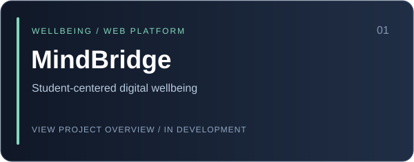
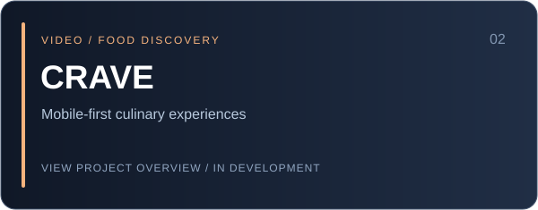
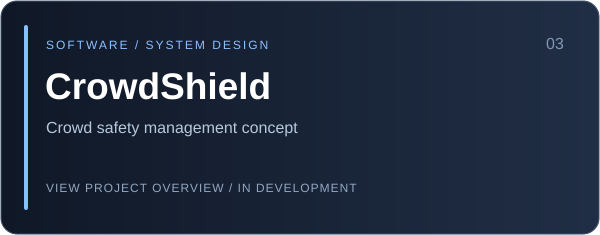
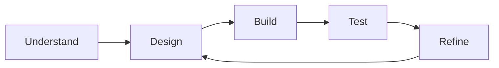

  
  
  

## About me

I'm a Software Engineering student at the University of Europe for Applied Sciences in Potsdam, Germany. I work at the intersection of software development, interface design and product thinking, with a particular interest in building useful, intuitive digital products.

- **Education:** BSc Software Engineering, University of Europe for Applied Sciences
- **Focus:** Backend development, software architecture and UI/UX
- **Currently exploring:** Distributed systems, computer networks and reusable software design
- **Availability:** Software engineering and product development internships in Germany from Summer 2027

## At a glance

| 🎓 Education | 💻 Engineering | 🎨 Design | 🌍 Career |
| :--- | :--- | :--- | :--- |
| BSc Software Engineering | Backend & system design | UI/UX & prototyping | Germany · Summer 2027 |
| University of Europe for Applied Sciences | Building practical software projects | Figma · Responsive web | Open to internships |

## Selected work

<table>
<tr>
<td width="50%"></td>
<td width="50%"></td>
</tr>
<tr>
<td width="50%"></td>
<td width="50%"><h3>Engineering notebook</h3>
Academic topics, technical exploration and my ongoing learning roadmap.
<a href="./learning/engineering.md">Explore learning areas →</a></td>
</tr>
</table>

| Project | Overview | Technologies / focus |
| :--- | :--- | :--- |
| [**MindBridge**](./projects/mindbridge.md) | A non-clinical student wellbeing platform | Python, FastAPI, web development |
| [**CRAVE**](./projects/crave.md) | A mobile-first short-form food video discovery experience | Web development, Supabase, product design |

MindBridge and CRAVE are private projects in development. CrowdShield is an academic project in development. Public summaries are available above.

## Technologies & tools

| Area | Tools |
| :--- | :--- |
| Programming |     |
| Web |    |
| Data |   |
| Design & workflow |    |

These are technologies I use or am actively learning, rather than claims of expert-level proficiency.

## Engineering labs — runnable code

| Lab | Engineering focus | Verification |
| :--- | :--- | :--- |
| [**RelayQueue**](./labs/relayqueue) | Durable job queue, transactional concurrency, idempotency, retries and lease recovery | Six automated test cases; [CI results](https://github.com/yigitegeozpamuk/yigitegeozpamuk/actions) |

AI-assisted learning projects with source code and documented tradeoffs. See each lab for setup, limitations and verification.

## Technical toolbox

## Academic & practical foundations

| Area | Topics and work |
| :--- | :--- |
| Software engineering | Requirements analysis, UML, software architecture and reusable design |
| Computer science | Programming fundamentals, computer architecture and distributed systems |
| Database systems | SQL, PostgreSQL and relational data modeling |
| Computer networks | Packet Tracer, VLANs, inter-VLAN routing and DHCP exercises |
| Product design | Wireframes, components, design systems and responsive interfaces |

[Explore my engineering learning journal →](./learning/engineering.md)

## How I approach building products

## Engineering interests

- Modular software architecture and object-oriented design
- API development and relational data modeling
- Accessible, responsive digital experiences
- Networking fundamentals and distributed systems
- Product prototyping and iterative design

## GitHub activity

Public activity only; private project work may not be reflected. Statistics depend on an external service.

## Development roadmap

- [x] Establish a public engineering portfolio
- [x] Document selected project concepts
- [ ] Publish standalone projects with reproducible setup
- [ ] Expand automated testing and CI knowledge
- [ ] Deepen backend architecture and networking skills

## Beyond code

I am interested in entrepreneurship, technology communities and the process of turning ideas into practical products. I also enjoy organizing student community initiatives, collaborating with others and exploring how design can make technology more approachable.

## Opportunities

Interested in internship opportunities involving software development, backend engineering, product engineering and UI/UX-oriented development. I value collaborative teams, practical learning and thoughtful engineering.

---

<b>Open to internship opportunities from Summer 2027.</b> Software Engineering · Backend Development · Product Development <a href="https://github.com/yigitegeozpamuk">GitHub profile</a>

