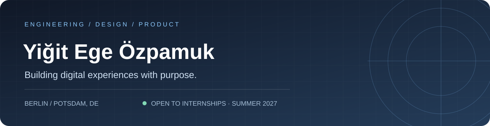

  
  
  

## About me

I'm a Software Engineering student at the University of Europe for Applied Sciences in Potsdam, Germany. I work at the intersection of software development, interface design and product thinking, with a particular interest in building useful, intuitive digital products.

- **Education:** BSc Software Engineering, University of Europe for Applied Sciences
- **Focus:** Backend development, software architecture and UI/UX
- **Currently exploring:** Distributed systems, computer networks and reusable software design
- **Availability:** Software engineering and product development internships in Germany from Summer 2027

## Selected work

| Project | Overview | Technologies / focus |
| :--- | :--- | :--- |
| [**MindBridge**](./projects/mindbridge.md) | A non-clinical student wellbeing platform | Python, FastAPI, web development |
| [**CRAVE**](./projects/crave.md) | A mobile-first short-form food video discovery experience | Web development, Supabase, product design |

Both projects are in development. Source code is private; public summaries are available above.

## Technologies & tools

| Area | Tools |
| :--- | :--- |
| Programming |     |
| Web |    |
| Data |   |
| Design & workflow |    |

These are technologies I use or am actively learning, rather than claims of expert-level proficiency.

## Engineering interests

- Modular software architecture and object-oriented design
- API development and relational data modeling
- Accessible, responsive digital experiences
- Networking fundamentals and distributed systems
- Product prototyping and iterative design

## GitHub activity

Public activity only; private project work may not be reflected. Statistics depend on an external service.

## Beyond code

I am interested in entrepreneurship, technology communities and the process of turning ideas into practical products.

---

<b>Open to internship opportunities from Summer 2027.</b> Software Engineering · Backend Development · Product Development <a href="https://github.com/yigitegeozpamuk">GitHub profile</a>

