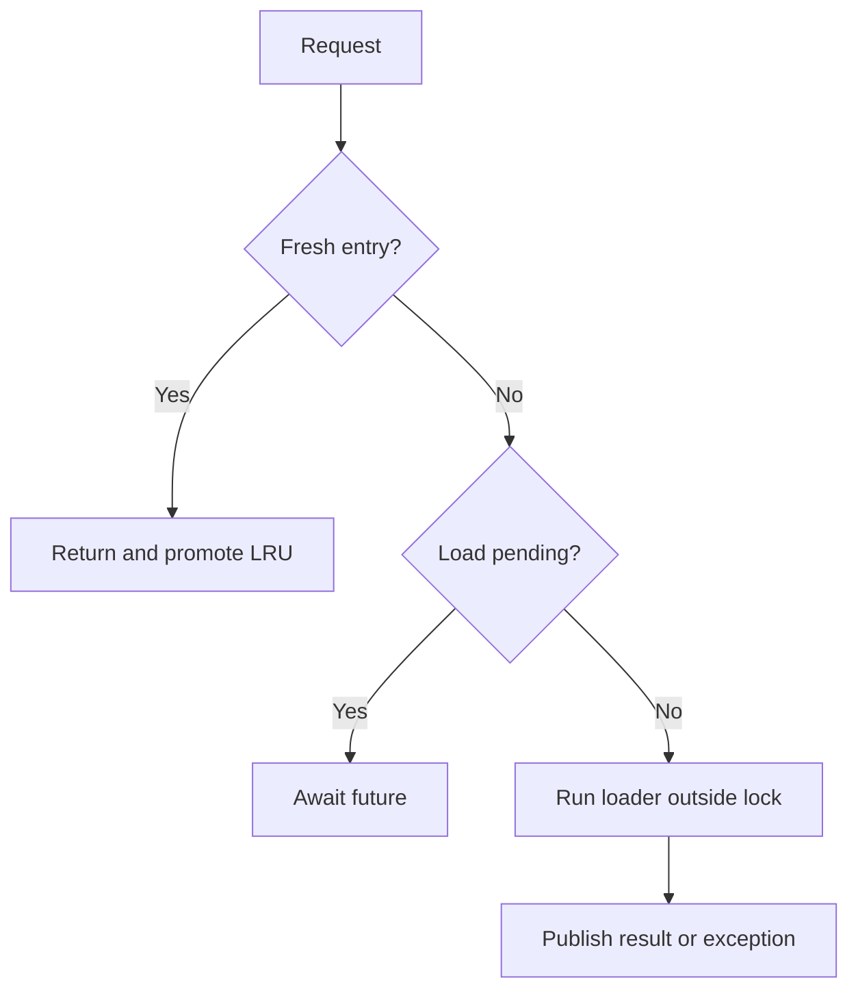

# CacheForge

A dependency-free Python learning implementation of a bounded concurrent cache. AI-assisted authorship; not a production service.

## Run

Python 3.11+.

```sh
cd labs/cacheforge
python cacheforge.py
python -m unittest -v
```

## Architecture

An OrderedDict stores values and monotonic expiration deadlines. A reentrant lock protects cache state and counters. A per-key Future coordinates concurrent misses; the leader executes the loader outside the lock and followers await its result. Failed loads are not cached.



## Tradeoffs

Hits and LRU promotion are O(1); successful insertions scan up to capacity entries to remove expired values. Capacity bounds stored entries, not in-flight requests or bytes. Misses count every request that lacks a fresh value, including followers. TTL starts when loading finishes. No background cleanup, persistence, distributed coherence, cancellation, or loader timeout. Loaders must not create cyclic dependencies between keys. Benchmarking and load limits are future work.

## Verification

Seven local unittest cases passed: cached None, expiration boundary, LRU, failed load retry, concurrent single-flight, recursive load rejection, invalid capacity. CI is configured separately; hosted results are not yet verified.

[Back to portfolio](../../README.md)
