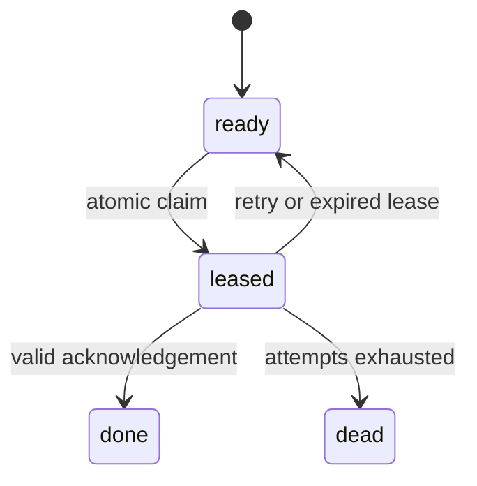

# RelayQueue — durable job execution

A backend engineering lab demonstrating transactional job claiming, idempotency, retry policies and crash recovery. Python 3.10+; no third-party dependencies.

## Quick start

```sh
cd labs/relayqueue
python demo.py
python -m unittest -v
```

## Architecture



SQLite is the durable source of truth. A BEGIN IMMEDIATE transaction serializes competing writers. Unique idempotency keys prevent duplicate enqueue operations; random lease tokens prevent stale workers from acknowledging a reclaimed job. Retry delays grow exponentially with a cap. Expired leases are reclaimed on the next claim.

## Engineering tradeoffs

- At-least-once execution, not exactly-once external side effects. Consumers must make their own effects idempotent.
- SQLite suits a local single-host prototype, not a horizontally scaled distributed broker.
- Wall-clock leases can be affected by clock adjustments. No heartbeats, authentication, network API, metrics exporter or dead-letter replay yet.
- The suite covers concurrency, restart persistence, idempotency, stale acknowledgements, retries and exhaustion. CI is configured; see Actions for actual execution results.
- Reference: https://docs.python.org/3/library/sqlite3.html

## Authorship

AI-assisted portfolio lab. Review the implementation, reproduce the tests and be prepared to explain the design before presenting it in an interview.
